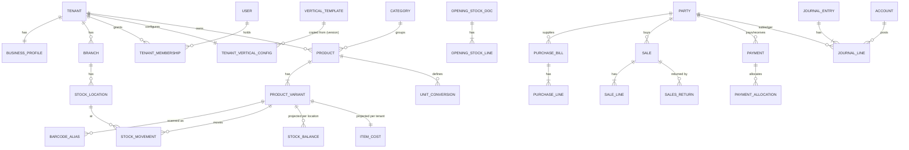

# Domain model, context map and ERD (Phase 1A)

Status: **Proposed.** This is not an accepted schema. Table names are illustrative.

## 1. Module context map

| Module | Owns | May call | Phase |
|---|---|---|---|
| Identity & Access | users, credentials, sessions | — | 1A |
| Tenancy & Setup | tenant, business profile, branch, stock location, membership, roles, onboarding checklist, number series | Audit | 1A |
| Catalogue | vertical template (global), tenant vertical configuration, category, product, variant, attributes, unit, conversion, barcode alias, supplier product ref | Tenancy, Audit | 1A |
| Inventory | stock movement, stock balance (proj), item cost (proj), opening-stock document, adjustment, import batch | Catalogue, Accounting, Audit | 1A |
| Parties | party, roles, credit terms | Audit | 1A |
| Purchasing | purchase bill (+ lines, charges), purchase return | Catalogue, Inventory, Parties, Tax, Accounting, Audit | 1A |
| Sales | sale (+ lines), sales return | Catalogue, Inventory, Parties, Tax, Accounting, Payments, Audit | 1A |
| Payments | payment, payment allocation | Accounting, Parties, Audit | 1A |
| Accounting | account, journal entry, journal line, period lock | Audit | 1A |
| Tax | tax rule version (global), tenant tax profile, document tax lines | — | 1A capture |
| Expenses | expense | Accounting, Tax, Audit | 1A-complete |
| Reporting | read-only queries/projections | read models | 1A-complete |
| Documents & Audit | audit event, idempotency record, stored document metadata | — | 1A |

Rule: Accounting never calls business modules. Cross-module writes happen only through the owning module's application interface, inside the caller's transaction.

## 2. Concept classification

Legend — Kind: AGG aggregate root, ENT entity, VO value object, REF global reference, CFG tenant config, MST tenant master data, TXN transaction record, ACC accounting record, TAX tax record, AUD audit, PRJ projection, INT integration.

| Concept | Kind | Module | Tenant | Source/Proj | Lifecycle | Key invariants | Audit | Phase |
|---|---|---|---|---|---|---|---|---|
| Tenant | AGG | Tenancy | is tenant | Source | Active → Suspended (later) | — | Yes | 1A |
| BusinessProfile | ENT (of Tenant) | Tenancy | Yes | Source | editable; changes audited | GST profile explicit (incl. "unknown") | Yes | 1A |
| Branch | MST | Tenancy | Yes | Source | Active/Inactive | ≥1 active branch | Yes | 1A |
| StockLocation | MST | Tenancy | Yes | Source | Active/Inactive | belongs to branch | Yes | 1A |
| User | AGG | Identity | No | Source | — | unique email | Sign-in events | 1A |
| TenantMembership | AGG | Tenancy | Yes | Source | Invited → Active → Revoked | ≥1 Owner per tenant | Yes | 1A |
| Role/Permission | REF (fixed in 1A) | Tenancy | No | Source (code/seed) | — | — | — | 1A |
| BranchAccess/LocationAccess | VO on membership | Tenancy | Yes | Source | — | subset of tenant's branches | Yes | 1A (all-access default) |
| VerticalTemplate | REF, versioned | Catalogue | No | Source | Draft → Published → Deprecated | immutable once published | — | 1A |
| TenantVerticalConfiguration | CFG | Catalogue | Yes | Source | copied from template version | never overwritten silently | Yes | 1A |
| AttributeDefinition | REF/CFG | Catalogue | template or tenant | Source | — | limited types | Yes (tenant) | 1A |
| Category | MST | Catalogue | Yes | Source | — | unique name per parent | — | 1A |
| Product | AGG | Catalogue | Yes | Source | Active/Inactive | ≥1 variant; generic flag | Yes | 1A |
| ProductVariant | ENT | Catalogue | Yes | Source | Active/Inactive | unique SKU per tenant; tracking mode | Yes | 1A |
| VariantAttributeValue | VO | Catalogue | Yes | Source | — | matches definition type | — | 1A |
| Unit | REF + CFG | Catalogue | global/tenant | Source | — | precision defined | — | 1A |
| UnitConversion | CFG per product | Catalogue | Yes | Source | immutable once used (new version instead) | factor > 0 | Yes | 1A |
| BarcodeAlias | ENT | Catalogue | Yes | Source | — | unique per tenant | Yes | 1A (Slice 2) |
| SupplierProductRef | ENT | Catalogue | Yes | Source | — | unique per supplier | — | 1A (Slice 4) |
| OpeningStockDocument | AGG | Inventory | Yes | Source | Draft → Posted → Reversed | lines with cost to post | Yes | 1A |
| StockMovement | TXN | Inventory | Yes | Source (append-only) | immutable | unique per source line/kind | via document | 1A |
| StockBalance | PRJ | Inventory | Yes | Projection | rebuildable | qty ≥ 0 (1A) | — | 1A |
| ItemCost | PRJ | Inventory | Yes | Projection | rebuildable | value = Σ movement values | — | 1A |
| StockAdjustment | AGG | Inventory | Yes | Source | Draft → Posted → Reversed | reason required | Yes | 1A-complete |
| ImportBatch / ImportRow | INT | Inventory | Yes | Source | Uploaded … Committed/Abandoned | commit-once | Yes | 1A (Slice 2) |
| Party | AGG | Parties | Yes | Source | Active/Inactive | roles flags | Yes | 1A |
| PurchaseBill (+lines, charges) | AGG | Purchasing | Yes | Source | Draft → Posted → Reversed | supplier role | Yes | 1A |
| PurchaseReturn | AGG | Purchasing | Yes | Source | Draft → Posted → Reversed | ≤ returnable qty | Yes | 1A-complete |
| Sale (+lines) | AGG | Sales | Yes | Source | Draft → Posted → Cancelled | number unique; stock ≥ 0 | Yes | 1A |
| SalesReturn | AGG | Sales | Yes | Source | Draft → Posted → Reversed | ≤ returnable qty | Yes | 1A |
| Payment | AGG | Payments | Yes | Source | Posted → Reversed | Σ allocations ≤ amount | Yes | 1A |
| PaymentAllocation | ENT | Payments | Yes | Source | removed only by reversal | same party | Yes | 1A |
| Account | MST | Accounting | Yes | Source | Active/Inactive | system accounts undeletable | Yes | 1A |
| JournalEntry / JournalLine | ACC | Accounting | Yes | Source | Posted → Reversed | balanced; immutable | Yes | 1A |
| PeriodLock | CFG | Accounting | Yes | Source | value history | server-enforced | Yes | 1A |
| TaxRuleVersion | REF | Tax | No | Source | Draft → Verified → Superseded | effective-dated | Yes | 1A |
| TenantTaxProfile | CFG | Tax | Yes | Source | effective-dated | explicit profile | Yes | 1A |
| DocumentTaxLine | TAX | Tax | Yes | Source | with document | sums match document | — | 1A |
| Expense | AGG | Expenses | Yes | Source | Draft → Posted → Reversed | category required | Yes | 1A-complete |
| AuditEvent | AUD | Audit | Yes | Source (append-only) | immutable | — | — | 1A |
| IdempotencyRecord | INT | Audit | Yes | Source | expires (retention TBD) | unique key per tenant+operation | — | 1A |
| NumberSeries | CFG | Tenancy | Yes | Source | — | monotonic | Yes | 1A |
| StoredDocument | ENT | Documents | Yes | Source | retention | random key | access audited | 1A (Slice 2+) |
| Job | INT | Jobs | Yes | Source | Pending → Running → Done/Failed | tenant not null | — | 1A (if needed) |

**Not tables in Phase 1A:** Batch, SerialNumber, Warranty, Loan, LoanSchedule, FixedAsset, BillingCounter, StockTransfer, StockCount, GoodsReceipt (separate), PurchaseOrder, Reconciliation, SavedReport, ReportSnapshot, LedgerBalance (computed by query until performance proves otherwise), separate CashAccount/BankAccount (ledger accounts with `kind`), FilingReminder, AccountantAccessGrant.

## 3. ERD (Phase 1A core)

Every relationship between tenant-owned tables is a composite FK including `tenant_id`. Source-document links from `stock_movement` and `journal_entry` use `(source_type, source_id)` plus a per-type FK where practical; the uniqueness of `(tenant_id, source_type, source_id, line_no, kind)` enforces once-only posting.

## 4. Extension points (no tables yet)

- `product_variant.tracking_mode` enum (`none` only in 1A) → future `tracked_unit` / `batch` tables.
- `stock_movement` nullable `tracking_ref` reserved → see `product-tracking-extensibility.md`.
- `stock_location` already supports multiple per branch → transfers later.
- `journal_line.party_id` → subledgers; `cost_center` not added.
