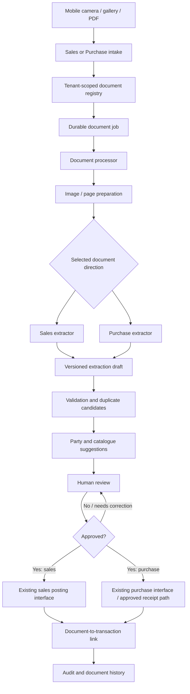

# Document ingestion and Document-to-Books architecture

**Status:** Discovery baseline and target architecture proposal; no schema or application code changes in WP0.  
**Baseline:** `main` commit `92c181f6f0ba861acac954545e7d630d07f3305c` (2026-11-26).  
**Product contract:** [docs/product/document-to-books.md](../product/document-to-books.md)  
**Decision:** [ADR-027](../adr/adr-027-document-to-books.md)  
**Continuation:** [DOCUMENT-TO-BOOKS-HANDOFF.md](../ux/DOCUMENT-TO-BOOKS-HANDOFF.md)

## 1. Current-state audit

The system already has two separate invoice capture implementations. They solve related extraction problems but currently have different upload, evidence, review and posting lifecycles.

### 1.1 Sales bill extraction

| Area | Current implementation |
|---|---|
| UI entry | `web/src/GenerateInvoice.tsx` → `web/src/SalesInvoiceCapture.tsx` |
| API | Authenticated `POST /api/sales/invoice-image-extract` |
| Input | One raw binary JPEG/PNG/WebP/PDF; max 8 MB |
| Processing | Synchronous request; image preprocessing via SkiaSharp; optional local Tesseract fast path capped at 900 ms |
| Providers | Direct Gemini model chain; optional Groq image fallback gated by `Groq:ItemTagFallbackEnabled`; image-only OCR/Groq path is skipped for PDF |
| Output | `ReadyForReview` or `NeedsAttention`, extracted header/lines/warnings |
| Confidence | A line-level confidence property is accepted; field-level confidence/provenance/geometry are not a complete contract |
| Evidence | Input is processed in memory and buffers are cleared; source image/PDF is not persisted |
| Review | Editable extracted-line review is embedded in Generate Invoice |
| Posting | Accepted rows enter normal Generate Invoice state and later the existing sales posting flow; AI endpoint has no posting authority |
| Source identity | Source invoice reference/date are distinct from RBOS invoice numbering |

Relevant files:
- `src/Rbos.Api/SalesInvoiceCaptureEndpoints.cs`
- `src/Rbos.Api/Application/SalesInvoiceCaptureService.cs`
- `web/src/SalesInvoiceCapture.tsx`
- `web/src/GenerateInvoice.tsx`
- `tests/Rbos.IntegrationTests/SalesInvoiceCaptureTests.cs`
- `web/e2e/invoice-extract.spec.ts`

### 1.2 Supplier purchase invoice extraction

| Area | Current implementation |
|---|---|
| UI entry | `web/src/Procurement.tsx` embeds `web/src/InvoiceUpload.tsx` in New Stock Entry |
| API | Authenticated `POST /api/purchases/extract` |
| Input | Multipart field `pages`; 1–6 pages of one invoice; max 8 MB/page and 12 MB combined; legacy JSON/base64 accepted |
| Processing | Synchronous request; supplier-specific extraction via `InvoiceExtractionService` |
| Providers | Gemini model fallback; optional Groq fallback controlled by `Groq:InvoiceFallbackEnabled` |
| Output | `InvoiceDraft`: supplier, reference/date, total/subtotal/tax and lines |
| Matching | Server proposes catalogue product and supplier matches by name |
| Confidence | No comparable field-level confidence/provenance contract |
| Evidence | Original page(s) stored in `procurement.invoice_file` as `bytea`; multiple pages are stored as a ZIP; row is staged with no receipt until later posting |
| Review | `InvoiceUpload` lets operator map each line to catalogue product, edit quantity/cost/GST and choose a supplier |
| Posting | UI carries selected lines and `invoiceFileId` to `POST /api/purchases`; purchase receipt attaches the file |
| Prompt limitation | Supplier prompt explicitly says to ignore handwriting |

Relevant files:
- `src/Rbos.Api/ProcurementEndpoints.cs`
- `src/Rbos.Api/Application/InvoiceExtractionService.cs`
- `src/Rbos.Api/Application/ProcurementService.cs`
- `web/src/InvoiceUpload.tsx`
- `web/src/Procurement.tsx`
- `db/migrations/014_purchase_invoice_files.sql`
- `db/migrations/015_invoice_file_zip.sql`

### 1.3 Current purchase posting is not a separate supplier-bill aggregate

Verified in `db/migrations/007_procurement.sql`, `db/migrations/038_purchase_gst.sql` and `ProcurementService.ReceiveAsync`:

- The current `procurement.purchase_receipt` stores supplier, location, receipt date, supplier reference, grand total, GST treatment, idempotency data and journal entry.
- `purchase_receipt_line` stores product, quantity, unit cost and GST/landed cost.
- `ReceiveAsync` posts the purchase journal and updates physical stock, WAC and supplier payable in one transaction.
- The uploaded supplier invoice is linked to the purchase receipt after the receipt posts.
- This model assumes the received quantities and supplier invoice lines are part of the same posting event. It does not represent an invoice for goods not yet received or a partial physical receipt independently.

Therefore an uploaded purchase invoice must not automatically be treated as evidence that all goods were received. The distinction between Purchase Bill and Goods Receipt is a financial/domain design gate, not an OCR detail.

### 1.4 Existing durable processing pattern

- ADR-018 accepts a PostgreSQL-backed jobs approach using leases and `FOR UPDATE SKIP LOCKED`, introduced only when a background job is needed.
- `db/migrations/050_durable_item_tag_capture_queue.sql` implements a durable identifier-only queue with lease token, expiry, attempt count and claim/finish/cancel functions for item-tag captures.
- This is a useful mechanics reference, not a document queue to reuse directly: document jobs need durable source evidence, processing versions, user-visible statuses, retry classification and document-level idempotency.
- Do not introduce an external message broker or a fire-and-forget in-memory worker for the first implementation.

### 1.5 Security and tenancy

- Both upload endpoints are authenticated and classified in `src/Rbos.Api/ApiRouteAccess.cs` (`SalesCreate` and `PurchasesManage`).
- Raw sales invoice uploads are restricted by the request security middleware; purchase multipart uploads have their own larger request cap.
- Purchase evidence table uses ENABLE + FORCE RLS and tenant policy in migration 014.
- New registry, files, extraction results, queue rows and transaction links must carry tenant ownership and enforce RLS/authorization. A tenant ID in a body, path or job payload is never authoritative.
- Never put raw documents, extracted names/phones or model-generated bill text in logs. Log safe metadata, timings, status and correlation identifiers.

## 2. Target architecture

Share the document lifecycle and operational infrastructure; keep sales and purchase interpretation and posting rules separate.

### 2.1 Shared lifecycle boundary

A proposed tenant-owned document aggregate should represent:

- Direction: `Sale` or `Purchase` (selected by user at intake; AI may recommend but cannot change it silently).
- Source kind: handwritten cash memo, handwritten invoice, printed invoice, thermal receipt, PDF or other supported bill.
- Source files and page grouping.
- Document metadata: upload actor/time, branch/location where applicable, content hash, page count, size, MIME and retention state.
- Status and status history.
- Processing attempts and extractor/schema version.
- Review draft and operator corrections.
- Duplicate candidates and resolution.
- Approval actor/time and one resulting transaction link, if posted.

Candidate concepts (not final table names/schema): `business_document`, `business_document_file`, `document_extraction_attempt`, `document_review_draft`, `document_duplicate_candidate`, `document_transaction_link`, and a durable document job. Prefer the smallest schema that satisfies this lifecycle; do not create one table per document format or duplicate existing source-of-truth transaction data.

### 2.2 Storage decision

Current evidence and deployment constraints:
- purchase invoice content is stored in PostgreSQL `bytea` in `procurement.invoice_file`;
- sales invoice content is not retained;
- ADR-017 proposed an `IDocumentStore` abstraction with local filesystem storage;
- the pilot deployment runbook targets Cloud Run + Neon PostgreSQL. A Cloud Run container's writable layer is not a durable document store across instance replacement, and no persistent volume or object-storage bucket is configured in the repository.

**WP1 pilot storage choice (proposed in this implementation PR):** store bounded source-page bytes in PostgreSQL `documents.document_page.content` (`bytea`) with tenant RLS. This reuses the existing durable database and backup path, avoids adding a paid object-storage dependency or new credentials, and keeps upload metadata, page evidence and queue enqueue in one database transaction. It is a deliberate Cloud Run pilot amendment to ADR-017's local-filesystem proposal, not a claim that database blobs are the ideal long-term scale architecture.

Hard limits in the intake contract:
- 8 MB per page;
- up to 6 pages per bill;
- up to 10 independent bills per batch;
- 24 MB aggregate file bytes per batch (26 MiB HTTP envelope).
The database backup/restore process must include these page rows. No automatic retention deletion is enabled; a tenant retention/deletion policy remains an explicit follow-up before broad rollout.

Revisit a private object store behind a storage abstraction when measured database growth, backup time or throughput justifies it and the owner approves its recurring cost. Do not use Cloud Run's local container filesystem for retained source evidence.

Required storage contract:
- opaque server-generated page IDs; never user-controlled storage paths;
- tenant-scoped metadata and RLS on batch, document and page rows;
- no public/static URLs; source bytes are returned only by authenticated tenant-authorized endpoints;
- content type and file-signature validation plus page/file/aggregate size limits;
- SHA-256 checksum for integrity and future duplicate detection;
- documented retention/deletion and backup/restore policy;
- bounded upload envelope and per-page reads.

### 2.3 Durable intake and worker model

Target upload sequence:

1. Validate user permission, file count, size, allowed media, signatures and page grouping.
2. Persist source document metadata and file references.
3. Persist a durable processing job referencing document ID and tenant ID only.
4. Commit the document and job atomically.
5. Return document IDs/status promptly; do not hold the mobile request open for provider inference.
6. Worker claims with a lease, loads the file under that tenant context, processes a bounded unit and records the attempt.
7. Retry transient provider/network/timeouts with bounded backoff; mark invalid/unsupported/low-quality input as requiring user action.
8. Worker completes only with its current lease token. Expired jobs can be reclaimed.
9. All state changes are guarded so retry/concurrency cannot create a second extraction or posting.
10. The user can cancel only work that has not entered a non-cancellable commit stage.

Use the existing ADR-018 PostgreSQL job pattern and migration-050 lease mechanics as the starting point. Decide whether to extend the existing generic job abstraction or introduce a document-specific queue only after inspecting the actual worker/runtime registration. Do not store file bytes in job payloads.

### 2.4 Separate extraction contracts

Common envelope:

- document ID, direction, source type;
- extraction schema version, model/provider metadata (safe identifiers only);
- status, warnings and processing timestamps;
- normalized header and line candidates;
- field-level provenance and confidence;
- page index and evidence location when supported;
- validation and duplicate findings.

Each field should distinguish:
- `Extracted`: read from document;
- `UserCorrected`: changed by operator;
- `Derived`: calculated by RBOS from confirmed inputs;
- `Matched`: suggested/confirmed link to a party or catalogue record.

Sales-specific contract retains external invoice reference/date, customer details if present, line description/model/brand/HSN, quantity/unit, selling rate, discount, tax evidence, amount and payment note when legible.

Purchase-specific contract retains supplier details, source invoice reference/date, line description/model/brand/HSN, quantity/unit, purchase rate, discount, tax evidence, amount, charges and grand total when legible.

Never combine supplier and customer meaning just because their documents contain similar fields. The selected direction determines the extractor and posting adapter.

### 2.5 Image and table understanding

Pipeline capabilities should be independently observable:
- validate actual signatures, not only MIME extensions;
- inspect page count and dimensions before provider calls;
- rotate and correct orientation;
- perspective/keystone correction for phone photos;
- improve contrast/illumination and reduce shadows;
- preserve enough resolution for handwriting and small amounts;
- split large page images into regions only when it helps and maintain a stable mapping back to original page;
- detect table header/columns and preserve row order;
- treat uncertain handwriting as unresolved, not as an invented catalogue description;
- support mixed scripts using a labelled evaluation set.

Tesseract remains a bounded supporting/printed-text path; it must not be represented as reliable handwriting recognition. Provider strategy must preserve existing RBOS owner policy: no new provider/credentials and no AI Gateway dependency for this capability unless the owner explicitly changes the decision. Keep current per-feature fallback flags until a deliberate provider-policy change is documented.

### 2.6 Validation, matching and duplicate handling

Before approval, validate:
- positive quantity and valid decimal precision;
- rate/discount/amount bounds;
- line calculations and invoice totals using the approved rounding rules;
- GST values only when supported by source evidence and tenant tax profile;
- source/customer/supplier/date consistency;
- line count and page completeness;
- unresolved/low-confidence fields;
- product/party matching evidence;
- duplicate candidates.

Use server-side calculations as authoritative. If quantity and amount are confirmed but rate is absent, a derived rate can be offered as a clearly labelled calculated suggestion. It must not be shown as an extracted value.

### 2.7 Review and posting adapters

- Document review never owns financial calculations.
- On approval, the document adapter prepares a domain command and passes it to the existing owning service.
- Sales must use the existing sales posting interface; do not duplicate journal, inventory, tax, return or idempotency code.
- Purchases must use the approved purchasing flow. Until Purchase Bill and Goods Receipt are separated, only post through the existing combined receipt path when the operator confirms all invoiced quantities were physically received at the selected location and line mapping is complete.
- Store the source document link in the same transaction or through a recoverable outbox/link step with an integrity check.
- The document may transition to Posted only after the transaction is committed and the linkage is verified.
- Reversals/corrections use the domain's existing reversal and adjustment rules.

## 3. Proposed implementation sequence

| WP | Scope | Main dependencies | Gate / output |
|---|---|---|---|
| WP0 | Current-state audit, product scope, ADR and handoff | Existing source and docs | Completed in discovery branch |
| WP1 | Document registry, storage adapter, upload, batch/page grouping, durable job, inbox status API | Storage policy, worker runtime, tenant/RLS design | Upload persists and resumes after process restart |
| WP2 | Versioned sales/purchase extraction, handwriting, image quality pipeline, validation and confidence | WP1, representative corpus | Per-field/line quality evidence, no posting |
| WP3 | Mobile inbox and review/correction UX | WP1/WP2 API contracts | Phone-first approved design and working review flow |
| WP4 | Sales and purchase posting integration | WP2/WP3; walk-in and purchase bill/receipt policies | One real posted sale and purchase each, fully reconciled |
| WP5 | Batch controls, retries, duplicate review, monitoring | WP1–WP4 | Partial failure recovery and no duplicate posts |
| WP6 | Pilot and launch readiness | WP1–WP5 | Labelled corpus, Android review, business and CA sign-off |

## 4. Minimal early test strategy

Respect the owner's request to avoid spending disproportionate time expanding unit tests in the first slices. Still keep high-risk controls covered.

Minimum flow/contract tests:
- one authenticated upload success and invalid/oversized file rejection;
- tenant A cannot read/download tenant B's file or document;
- upload retry with the same idempotency key does not create duplicate document records/jobs;
- worker lease expiry/reclaim and attempt limit;
- document state cannot move to Posted without an approved draft and a committed domain transaction;
- same document cannot post twice under concurrent approval/retry;
- one sales happy path and one purchase happy path, each asserting the resulting transaction link and key financial totals.

Defer exhaustive parser permutations, every arithmetic branch, all provider failure permutations and comprehensive component unit coverage to a later hardening pass. Use a small fixed real-document evaluation set as a product-quality check; it is not a substitute for automated contract tests.

## 5. Risks and unresolved gates

| Risk / decision | Safe interim rule | Owner |
|---|---|---|
| Purchase invoice does not prove goods received | Never create inventory receipt from invoice alone; hold for confirmation | Product owner + CA |
| Partial receipt / invoice timing | Do not post through combined receipt path; design separate bill/receipt model | Product owner + CA |
| Sales bill has no buyer name/mobile | Preserve existing named-customer validation; define Walk-in/Cash Sale transaction mode before importer posting | Product owner + CA |
| Source-document retention | Define tenant access, retention, deletion, backup and restore before shared file store | Product owner |
| Provider cost/accuracy | Use configured existing providers and bounded budgets; measure corpus results | Product owner |
| False confidence | Treat model scores as hints until calibrated | Engineering |
| Product matching mistakes | Suggest only; operator confirms; no silent catalogue creation | Product owner |
| Batch upload memory/latency | Durable async work; streaming upload/storage | Engineering |
| Tenant isolation / logs | RLS + permission checks; log metadata only | Engineering |

## 6. Non-goals for this architecture stage

No schema migration, new provider, credential/configuration change, AI Gateway change, live provider request, production data operation, production migration or deployment is part of WP0. The current docs are a proposed design contract, not proof of implementation.
